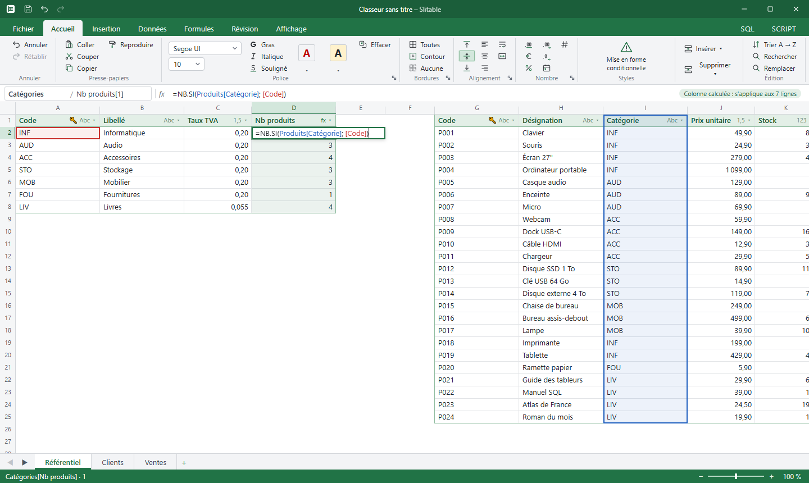
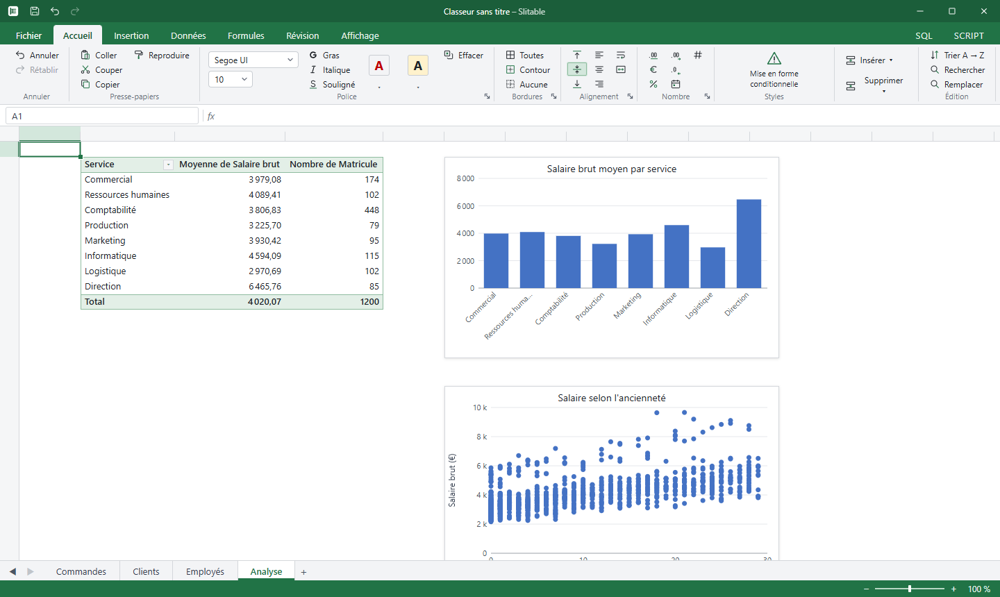
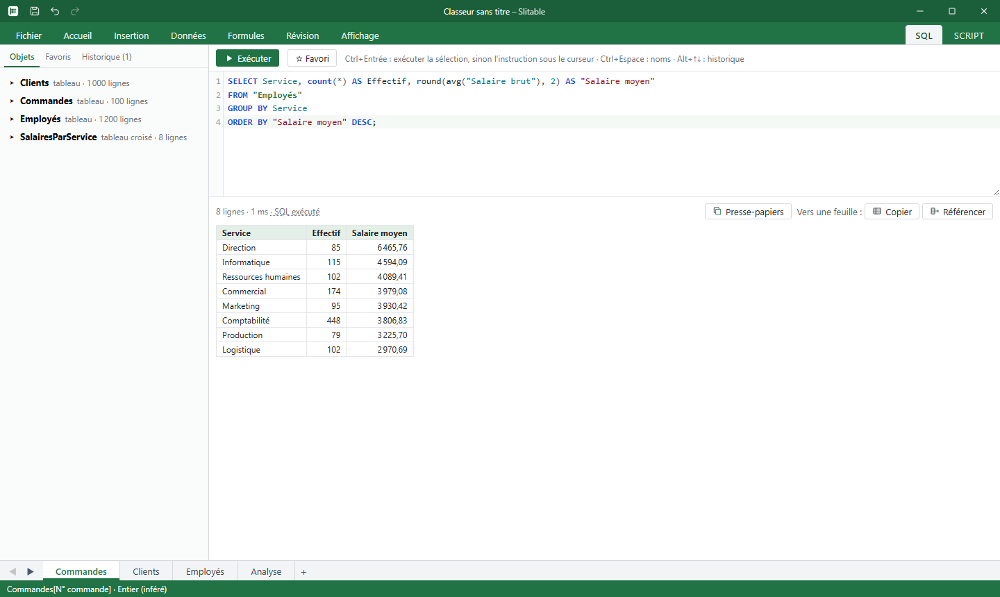
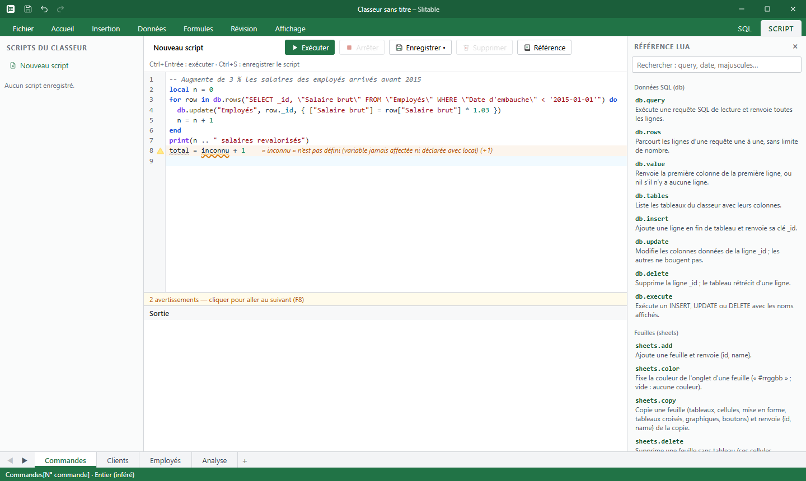
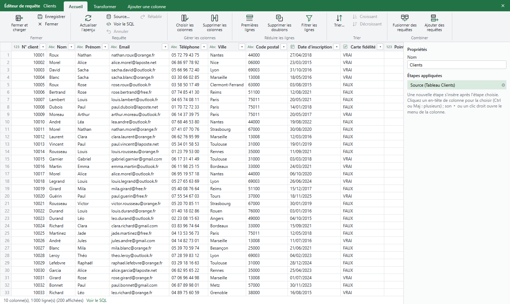

# Lattis

**Le tableur que vous connaissez, avec une vraie base de données dessous.**

Lattis a la souplesse d'Excel : une grille infinie, des formules en français, un ruban familier, Ctrl+C / Ctrl+V. Chaque tableau que vous tapez est en réalité une table **SQLite** typée, indexée et interrogeable en SQL. Résultat : un million de lignes ne fait plus peur, les données restent propres, et vous pouvez passer à tout moment de la souris au SQL, ou au script.

Application de bureau native (Go + Wails), **local-first** : vos classeurs sont de simples fichiers `.lattis`, sans compte ni cloud ni abonnement.



---

## Pourquoi Lattis ?

| Dans un tableur classique… | Dans Lattis |
| --- | --- |
| Une plage de cellules sans structure | **Chaque tableau est une table** : colonnes typées (texte, entier, décimal, date, booléen), clé unique détectée automatiquement |
| `RECHERCHEV` fragile, décalée dès qu'on insère une colonne | `REFERENCE(Produits[Prix]; [Code])` : une jointure par **nom de colonne**, qui ne casse pas |
| Le fichier rame au-delà de 100 000 lignes | Défilement instantané sur **1 million de lignes** et plus : seules les lignes visibles sont lues |
| Les données sont prisonnières de la feuille | **Onglet SQL** intégré : interrogez vos tableaux, croisés dynamiques compris, comme des tables |
| Macros VBA risquées | **Scripts Lua** en bac à sable, impossibles à bloquer : une boucle infinie est interrompue |

## Ce que vous pouvez faire

### Saisir comme dans Excel, sans rien déclarer

Tapez quelques lignes n'importe où : Lattis reconnaît l'îlot de données, met l'en-tête en valeur, devine le type de chaque colonne et crée la table correspondante. Collez depuis Excel, glissez un tableau à côté d'un autre pour les fusionner, annulez tout avec Ctrl+Z.

Les formules parlent français (`SOMME.SI`, `NB.SI`, `SI`, `ARRONDI`…) et désignent les colonnes par leur nom : `=[Quantité]*[Prix unitaire]` s'applique à toute la colonne, comme un tableau structuré d'Excel. Les références sont colorées pendant la saisie et se placent d'un clic, et la colonne calculée concernée est mise en évidence.

### Analyser : tableaux croisés et graphiques



- **Tableaux croisés dynamiques** calculés par SQLite (`GROUP BY`) : lignes, colonnes, plusieurs valeurs, pourcentages, filtres de rapport et tri directement dans la grille.
- **Graphiques** (barres, colonnes, courbes, aires, secteurs, anneaux, nuages de points) branchés sur un tableau ou un TCD, et mis à jour avec lui.
- Mise en forme conditionnelle, filtres et tris comme dans Excel, suppression des doublons, validation des données.

### Interroger en SQL



L'onglet **SQL** liste les objets du classeur et exécute vos requêtes sur les noms que vous voyez à l'écran (`"Employés"`, `"Salaire brut"`), avec complétion, historique et favoris. Les tableaux croisés s'interrogent comme des vues. Un résultat se copie dans une feuille, ou s'y **référence** pour rester à jour.

### Automatiser en Lua



L'onglet **Script** offre un vrai éditeur : coloration syntaxique, linter en direct (variables non définies, fautes de frappe dans l'API, `end` manquant) et une référence intégrée. Il donne accès à l'API `db.query`, `db.update`, `sheets.*`, `ui.*`… Les scripts tournent dans un bac à sable, et tout ce qu'ils modifient s'annule en un Ctrl+Z. Ceux d'un classeur reçu demandent votre accord à leur première exécution. → [Guide du scripting](docs/scripting-lua.md)

### Importer et transformer les données (façon Power Query)



L'éditeur de requêtes importe des données depuis :
- des fichiers CSV, Excel, JSON ou Parquet ;
- une base SQLite, PostgreSQL, MySQL ou SQL Server ;
- le web ;
- un autre tableau du classeur.

Chaque transformation devient une étape rejouable : filtrer, trier, choisir des colonnes, regrouper, fusionner, pivoter et dépivoter, fractionner, ajouter une colonne… Un clic sur une colonne la sélectionne, et Ctrl+Z retire la dernière étape. Le résultat se charge dans un tableau et s'actualise à la demande.

### Et aussi

- **Import / export** `.xlsx` et `.csv`, export `.ods` (formules traduites, mise en forme, tableaux), impression.
- **Serveur MCP** intégré : laissez un assistant comme Claude lire et modifier le classeur ouvert, en local et avec un jeton. → [docs/mcp.md](docs/mcp.md)
- **Fichier `.lattis`** : une seule archive (base SQLite + manifeste), facile à envoyer par e-mail ou à archiver, avec enregistrement atomique et récupération après incident. L'historique d'annulation et les données supprimées n'y sont jamais enregistrés. Ouvert depuis un dossier partagé, il est signalé aux autres postes (`~$nom.lattis`, comme Excel), et un fichier modifié ailleurs n'est pas écrasé sans question. Le format est décrit dans [docs/format-lattis.md](docs/format-lattis.md) : ce qu'un autre outil peut y lire ou y écrire.
- **Commune d'un point GPS**, hors ligne : `=COMMUNE([Latitude]; [Longitude])` donne la commune française (ou son code INSEE, son code postal, son département, sa région) à partir des contours officiels embarqués, même sur 100 000 lignes. Contient des données IGN et INSEE, Licence Ouverte / Etalab 2.0. → [docs/fonctions.md](docs/fonctions.md#géographie)
- Protection de feuilles et de classeur, notes façon post-it, cellules fusionnées, volets figés, zoom, animations de sélection.

## Les performances, mesurées

Sur un tableau de **1 000 000 de lignes** (poste de développement, Windows 10) :

| Opération | Temps |
| --- | ---: |
| Défiler n'importe où dans le tableau | 1 à 9 ms |
| Insérer ou supprimer une ligne au milieu | 10 à 35 ms |
| Ajouter une colonne calculée | 2 ms |
| Coller 100 000 × 10 cellules en zone libre | 2,5 s |
| Tableau croisé déjà calculé | instantané (en cache) |

Le détail est dans [docs/mesures/performances-1M.md](docs/mesures/performances-1M.md) et dans l'[audit des gros jeux de données](docs/audit-performance-gros-jeux.md).

**Limites connues** sur un million de lignes et plus : trier un tableau large prend de 10 s à plusieurs minutes, changer le type d'une colonne ou supprimer une colonne reconstruit la table (quelques secondes à une minute), un `UPDATE` SQL sur toutes les lignes prend 20 à 70 s, et l'enregistrement d'un classeur modifié réécrit tout le fichier (14 s pour 2,2 Go). L'état de chaque point est tenu dans l'[audit des gros jeux de données](docs/audit-performance-gros-jeux.md#état-au-19-octobre).

## Essayer

```bash
go run . --demo med      # vitrine : document, carte, jauge, TCD en arborescence, requête SQL, scripts, page HTML
go run . --demo refs     # 5 tableaux reliés par des REFERENCE, SOMME.SI, NB.SI
go run . --demo 1Mx10    # un million de lignes
go run . --demo docs/demo/exemple.yaml   # classeur décrit par un fichier YAML (docs/demo.md)
go run . --help          # toutes les options
```

---

## Pour les développeurs

### Stack

- **Backend Go** : SQLite en WAL (`ncruces/go-sqlite3`), une file d'écriture unique et un pool de lecture, un bus de commandes réversibles avec journal d'annulation persisté dans la copie de travail (jamais dans le fichier enregistré), et `gopher-lua` pour les scripts.
- **Frontend SvelteKit / Svelte 5** : grille dessinée en `<canvas>`, CodeMirror pour les éditeurs SQL et Lua.
- **Wails v3** : un binaire natif, sans Electron.

### Prérequis

- Go 1.26 (imposé par `ncruces/go-sqlite3` ; avec `GOTOOLCHAIN=auto`, Go le télécharge tout seul)
- Node 22
- Wails v3 : `go install github.com/wailsapp/wails/v3/cmd/wails3@v3.0.0-beta.30`
- Linux : `libgtk-4-dev libwebkitgtk-6.0-dev`

### Commandes

```bash
wails3 build          # binaire dans bin/
go test ./internal/...
cd frontend && npm run check && npm test
LATTIS_BENCH=resultat.json ./bin/lattis   # mesure automatique de la grille
go run . --demo med [--seed 42]                 # ouvre un classeur de démonstration
go run . --sql                                  # journal des requêtes SQL dans la console
```

### Données de démonstration

`--demo [preset]` ouvre un classeur neuf rempli de fausses données plausibles. Le générateur est déterministe : la même `--seed` donne le même classeur. Sans preset, c'est `med` qui s'ouvre ; un preset inconnu affiche la liste. `--demo plan.yaml` fabrique le classeur décrit par un fichier YAML (onglets, tableaux et générateurs de colonnes, formules, TCD, graphiques, contrôles, requêtes, documents, pages, scripts) : format dans [docs/demo.md](docs/demo.md), exemple dans [docs/demo/exemple.yaml](docs/demo/exemple.yaml) ; `--seed` l'emporte sur la graine du fichier.

| Preset | Contenu |
| --- | --- |
| `1Kx10`, `10Kx10`, `100Kx10`, `1Mx10`, `10Mx10` | 1 onglet de commandes, de 1 000 à 10 M lignes × 10 colonnes |
| `1Kx100`, `10Kx100`, `100Kx100`, `1Mx100`, `10Mx100` | 1 onglet de relevés météo (stations et capteurs), × 100 colonnes |
| `sml` | 100 lignes × 10 colonnes, 1 onglet |
| `med` | la vitrine (10 onglets) : un Document « À découvrir » (texte, graphique et TCD vivants, bouton Lua, champ lié), Ventes (2 000 commandes à clé, REFERENCE, mise en forme conditionnelle, liste qui pilote des formules, boutons), Villes (carte OpenStreetMap), Synthèse (TCD en arborescence avec sous-totaux, compartimentage, radar), Ventes mensuelles (requête SQL avec fonctions de fenêtre, actualisable par F5 ; combiné, jauge, cascade), Impayés (requête façon Power Query), une page HTML, Clients, Employés et Analyse |
| `big` | `med`, plus 8 onglets de 5 à 50 colonnes et de 100 à 100 000 lignes |
| `refs` | 5 tableaux sur 3 onglets reliés par des `REFERENCE` en chaîne, `SOMME.SI` et `NB.SI` |

En Go : `demo.New(ctx, "med", demo.Options{Seed: 42})` (internal/demo), ou `demo.Build` pour ajouter un preset à un classeur ouvert. `LATTIS_DEMO_LOURD=1 go test ./internal/demo/` fabrique aussi les gros presets.

### Organisation

```
main.go               point d'entrée Wails (à la racine : les tâches Wails l'attendent ici)
internal/bridge/      API exposée au frontend, seule couche qui dépend de Wails
internal/doc/         un classeur ouvert : archive + base + journal + modèle
internal/archive/     fichier .lattis : extraction, verrous, enregistrement atomique sans historique, récupération
internal/meta/        schéma des tables _lattis_* et migrations
internal/command/     bus de commandes réversibles, journal d'annulation de la session
internal/canvas/      modèle canevas ↔ tables : îlots, lignes, colonnes, types, TCD, graphiques
internal/formula/     analyse et calcul des formules (traduites en SQL quand c'est possible)
internal/geo/         contours des communes embarqués (go generate) : commune d'un point GPS, hors ligne
internal/query/       requêtes d'import (sources externes et étapes de transformation)
internal/script/      moteur Lua en bac à sable
internal/api/         commandes communes aux scripts et au serveur MCP
internal/mcp/         serveur MCP local
internal/transfer/    import / export xlsx et csv, impression
internal/store/       SQLite : WAL, pool de lecture, file d'écriture unique, autorisateur du SQL de l'utilisateur
internal/trust/       accords de l'utilisateur hors des classeurs (scripts par version, hôtes réseau)
internal/demo/        générateur de fausses données et presets --demo
internal/grid/        lecture par fenêtres (ancres + clé d'ordre)
internal/order/       clés d'ordre fractionnaires (_pos)
frontend/             SvelteKit en SPA (adapter-static) ; feuille dans src/lib/grid, ruban et onglets dans src/lib/shell
```

Les bindings TypeScript (`frontend/bindings`) sont générés par `wails3 generate bindings` (fait par `wails3 build`) et importés via `#bindings/...`.

## Licence

Lattis est un logiciel libre, sous [Mozilla Public License 2.0](LICENSE) : vous pouvez l'utiliser, l'étudier, le modifier et le redistribuer. Les fichiers modifiés restent sous MPL-2.0 et leur code doit être publié avec la version distribuée ; le reste d'une application qui intègre Lattis peut garder sa propre licence.

Le nom « Lattis », « Be-Lattis » et le logo ne font pas partie de cette licence : voir [TRADEMARKS.md](TRADEMARKS.md). Les composants et données de tiers sont listés dans [NOTICE.md](NOTICE.md). Le Serveur Lattis, logiciel distinct, est sous licence AGPL-3.0 ([lattis-server](https://github.com/Be-Lattis/lattis-server)).
